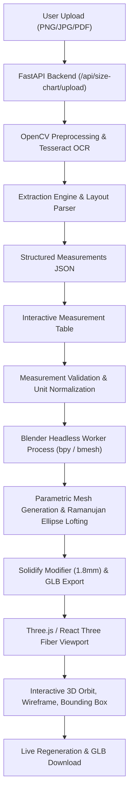

# 3D Garment Studio

> **Automated Size Chart Extraction + Parametric 3D T-Shirt Generation Engine**

3D Garment Studio is a professional interactive web studio for automated apparel engineering. It bridges 2D clothing specification charts and 3D digital apparel by running OCR table extraction on uploaded size charts, validating and grading parametric measurements, and mathematically generating standalone, watertight 3D garments through automated Blender Python geometry workers for real-time inspection in an interactive Three.js viewport.

---

## Key Highlights & Architecture

- **Standalone 3D Garments**: Dedicated standalone apparel geometry (no avatar, body collision, or fitting required).
- **OCR Size Chart Extraction**: Automatic optical character recognition using Tesseract & OpenCV with support for PNG, JPG, JPEG, and PDF documents. Distinguishes finished garment measurements from body measurements.
- **Editable Measurement Matrix**: Interactive table supporting S, M, L, XL, XXL with confidence indicators, custom measurement rows, and dynamic metric/imperial unit conversions ($cm \leftrightarrow inch$).
- **Parametric Blender Geometry Engine**:
  - Lofted cross-sections with numerical **Ramanujan Ellipse Circumference Solving** for accurate chest, waist, and hem circumferences.
  - Realistic shoulder slope ($13.5^\circ$), collar drop, and set-in sleeve heads with seamless quad/tri topology stitching.
  - Solidify modifier ($1.8\text{ mm}$ physical fabric thickness) with soft cotton PBR material.
- **Live 3D Studio Viewport**:
  - Powered by Three.js & React Three Fiber (`@react-three/fiber`, `@react-three/drei`).
  - Solid shading, Wireframe mode, and Solid + Wireframe overlay.
  - Camera presets: Perspective, Front, Back, Left, Right, Top.
  - Live 3D bounding box helper and physical dimensions inspector.
- **Live Model Regeneration**: Fine-tune chest, shoulder, length, or sleeve values on the fly; the Blender worker regenerates and live-updates the 3D viewport without application reload.
- **Production Asset Export**: One-click download of binary glTF 2.0 (`.glb`) assets alongside complete dimensional JSON metadata.

---

## System Architecture



---

## Project Structure

```
3d-garment-studio/
├── frontend/                     # React 18 + Vite + TypeScript + Three.js
│   ├── src/
│   │   ├── components/
│   │   │   ├── Header.tsx                 # Studio navigation, workflow steps, export
│   │   │   ├── StatusBar.tsx              # Engine state, polygon count, dimensions
│   │   │   ├── FileUpload.tsx             # Drag-and-drop & sample chart loader
│   │   │   ├── SizeChartPreview.tsx       # OCR thumbnail, confidence badge, raw transcript
│   │   │   ├── MeasurementTable.tsx       # Spreadsheet editor, unit switch, size highlight
│   │   │   ├── SizeSelector.tsx           # Segmented size switcher (S, M, L, XL, XXL)
│   │   │   ├── GarmentSettings.tsx        # Fit, sleeve cut, neckline options & generate button
│   │   │   ├── GarmentViewport.tsx        # Three.js Canvas, GLTFLoader, lighting, camera
│   │   │   ├── ViewportToolbar.tsx        # View presets, solid/wireframe, bounding box
│   │   │   ├── ModelProperties.tsx        # Right panel, physical dimensions, live tuning
│   │   │   ├── ExportPanel.tsx            # GLB download & metadata export
│   │   │   └── SizeComparisonModal.tsx    # Multi-size grading comparison matrix
│   │   ├── services/
│   │   │   └── api.ts                     # API client for backend communication
│   │   ├── types/
│   │   │   ├── measurements.ts            # Size chart & measurement types
│   │   │   └── garment.ts                 # Garment configuration & 3D metadata
│   │   ├── App.tsx                        # Main studio workspace orchestrator
│   │   └── main.tsx                       # React application bootstrap
│   ├── package.json
│   ├── tailwind.config.js
│   └── vite.config.ts
├── backend/                      # FastAPI Python Application
│   ├── api/
│   │   ├── upload.py                      # Size chart upload endpoint
│   │   ├── extraction.py                  # OCR extraction & chart CRUD
│   │   ├── garments.py                    # Garment generation trigger & async job status
│   │   └── models.py                      # GLB asset serving & metadata endpoints
│   ├── services/
│   │   ├── ocr_service.py                 # PyMuPDF, OpenCV preprocessing & Tesseract
│   │   ├── extraction_service.py          # Table parser, unit detection, half-chest correction
│   │   └── blender_service.py             # Spawns headless Blender subprocess & job tracking
│   ├── geometry/
│   │   ├── torso_generator.py             # Ramanujan ellipse solver & ring coordinates
│   │   └── generate_sample_chart.py       # Sample size chart generator
│   ├── blender_engine/
│   │   └── garment_builder.py             # Production Blender Python script (bmesh / bpy)
│   ├── validation/
│   │   └── measurement_validator.py       # Physical sanity checks & metric normalization
│   ├── models/
│   │   └── schemas.py                     # Pydantic models
│   ├── tests/
│   │   └── test_api.py                    # End-to-end integration test suite
│   └── main.py                            # FastAPI app entry point
├── storage/
│   ├── uploads/                           # Uploaded charts
│   ├── generated_models/                  # Exported GLB files & metadata JSONs
│   └── sample_size_chart.png              # Standard sample size chart
├── docs/                                  # Documentation & screenshots
└── README.md
```

---

## Mathematical Formulation

### 1. Ellipse Circumference Solving (Ramanujan's Formula)
Given target circumference $C$ and aspect ratio $r = a / b$ (lateral semi-major axis over sagittal semi-minor axis, $r \approx 1.45$ for regular fit chest):

$$C \approx \pi \left[ 3(a + b) - \sqrt{(3a + b)(a + 3b)} \right]$$

Substituting $a = r \cdot b$:

$$C \approx \pi \cdot b \left[ 3(r + 1) - \sqrt{(3r + 1)(r + 3)} \right]$$

$$b = \frac{C}{\pi \left[ 3(r + 1) - \sqrt{(3r + 1)(r + 3)} \right]}, \quad a = r \cdot b$$

A Newton-Raphson refinement step is applied to ensure accuracy within $\pm 0.05\text{ mm}$.

### 2. Lofted Torso Geometry
Cross sections are evaluated from the hem ($Z = 0$) through waist ($Z \approx 0.44 L$) to the underarm ($Z = L - \text{armhole\_depth}$):
- $a(z)$ and $b(z)$ smoothly interpolate between hem, waist, and chest circumferences.
- Subtle organic curvature offsets are applied ($+0.005\text{ m}$ anterior bias) to match authentic human apparel draping.

### 3. Upper Torso & Set-In Sleeves
- **Neckline**: Front collar drop ($0.095\text{ m}$ for round neck, $0.14\text{ m}$ for V-neck) and back collar drop ($0.028\text{ m}$) with an extruded ribbed collar rim.
- **Shoulder Slope**: $13.5^\circ$ downward inclination from high shoulder point to shoulder tip.
- **Sleeves**: Lofted cylindrical sleeves projected along a $35^\circ$ relaxed drape vector, smoothly tapering from armhole circumference to cuff circumference, seamlessly stitched to the torso perimeter.

---

## Installation & Setup

### Prerequisites
- macOS / Linux / Windows
- Python 3.10+ (with virtual environment)
- Node.js 18+ & npm
- Blender 4.x / 5.x installed and accessible via `blender` or `/opt/homebrew/bin/blender`
- Tesseract OCR (`brew install tesseract` on macOS, `apt install tesseract-ocr` on Ubuntu)

### Backend Setup

```bash
cd backend
python3 -m venv venv
source venv/bin/activate
pip install -r ../requirements.txt  # or: pip install fastapi uvicorn pydantic python-multipart pillow opencv-python-headless pytesseract numpy scipy trimesh pymupdf httpx pytest pytest-asyncio
```

Run tests:
```bash
PYTHONPATH=. backend/venv/bin/pytest backend/tests/test_api.py -v
```

Start the Backend API server:
```bash
PYTHONPATH=. backend/venv/bin/uvicorn backend.main:app --host 0.0.0.0 --port 8000 --reload
```

### Frontend Setup

```bash
cd frontend
npm install
npm run dev
```

The application will be live at `http://localhost:5173`.

---

## API Reference

| Method | Endpoint | Description |
|---|---|---|
| `POST` | `/api/size-chart/upload` | Upload PNG, JPG, JPEG, or PDF size chart |
| `POST` | `/api/size-chart/extract` | Run OCR extraction and return structured measurement JSON |
| `GET` | `/api/size-chart/{chart_id}` | Retrieve extracted measurement data |
| `PUT` | `/api/size-chart/{chart_id}` | Update and persist user-corrected measurements |
| `POST` | `/api/garments/generate` | Trigger parametric Blender geometry worker |
| `GET` | `/api/garments/jobs/{job_id}` | Poll generation job progress and status |
| `GET` | `/api/models/{filename}` | Stream binary GLB model asset for Three.js |
| `GET` | `/api/models/{filename}/metadata`| Retrieve physical dimensions and vertex counts |
| `GET` | `/api/health` | Health check endpoint |

---

## License
MIT License. Built for interactive 3D fashion design and parametric apparel engineering.
